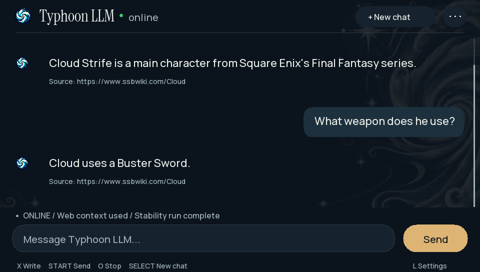

# TyphoonLLM Online

**Experimental technology demo. Known answer-quality failures remain.** Six earlier 00.18 multi-step device tests produced **0/6 complete passes**. Answers can contain wrong arithmetic, omit instructions, or contradict supplied sources. The earlier companion routing fix did not correct the budget answer or demonstrate a faster full response. See [current status](STATUS.md), [the six-task report](validation/MULTISTEP-00.18.md), and [the follow-up](validation/COMPANION-FOLLOWUP.md).

[Download experimental 01.00](https://github.com/daivarsi/TyphoonLLM-Online/releases/tag/v01.00). **A separate Vita app with its own model/data folder and downloads.** No offline TyphoonLLM installation is required. [See real Vita prompt/output screenshots](docs/SCREENSHOTS.md).

The Vita generates every answer locally. The trusted-LAN PC companion classifies requests, retrieves documents, and supplies optional source text. It never generates chatbot answers. This is useful for experimenting with the pipeline; it is not a dependable factual or reasoning assistant.

*Actual 01.00 capture with the original header restored. See [01.00 validation](validation/ONLINE-01.00.md) and the [screenshot gallery](docs/SCREENSHOTS.md), including older failures.*

01.00 encodes spaces and Unicode in fetched URLs and redirects, and isolates HTTP failures so one bad result cannot discard valid evidence. It restores the original in-app header. Update both the app and companion.

## One answer pipeline

1. The original user request goes to the companion unchanged. A pinned, pretrained zero-shot classifier distinguishes obtaining existing information, creating new content, transforming supplied text, social conversation, explicit research and deductions from supplied data. All local routes require positive binary entailment support. General editing/social paraphrases cover alternative formulations; an unsupported winning label does not suppress research. This is learned action classification, not a question-prefix whitelist or entity exception. The former free-form Vita query planner has been removed.
2. Local tasks return without fetching source text. Research tasks use Wikipedia full-text search and actual pages found through public Mwmbl search. The previous source is considered for follow-ups but must still pass current-request relevance. Search snippets are never evidence.
3. A separate pinned relevance model orders search results for fetching, ranks actual documents, then ranks their complete source passages. Current-request relevance can admit a new topic independently of the previous source. Article and section context accompany Wikipedia sentences. The selected document's opening context accompanies its best detail when both fit the bounded evidence budget. The original request, retained user/source context and admitted text form the sourced-generation input.
4. The Vita generates its own answer. For sourced generation, previous generated assistant claims are omitted from inference, while user requests and reference text remain. The canonical conversation and displayed replies are retained; local tasks still receive ordinary conversation history. This prevents an earlier generated falsehood from being reused as evidence. The companion never generates chatbot answers. A missing, irrelevant, failed or oversized lookup leads to ordinary local generation. Empty or literal-question-echo sourced output retries once from the pre-turn conversation.

Neither classifier nor ranker is a truth checker. Public search coverage can be poor and providers can rate limit requests. The model may copy source wording or be wrong even when transport and source selection work. A source footer is not an accuracy certificate.

The client allows 45 seconds for lookup. The companion allows up to 35 seconds overall, including classification and ranking, with 25 seconds for collection. One active source worker prevents abandoned request accumulation. Stop remains available.

The 512-token context reserves space for a complete concise response and evicts whole old turns when necessary. Each sourced request includes its current evidence explicitly. New Chat clears dialogue and reference state and resets companion caches; old in-flight results cannot refill the current result/document cache.

## Install or update

Follow [INSTALL.md](INSTALL.md) for exact Windows setup commands, pinned asset downloads, hash checks, connection setup and update instructions. Start from the source archive in the **same 01.00 release**.

Online has its own bubble, title **VLMNET001**, and all data under `ux0:data/TyphoonOnline/`. Offline **VLMCHAT01** retains its own files. Version 00.19 removed shared model paths. Version 00.20 updates routing, evidence context and sourced inference; model contents and clock settings are unchanged. Triangle toggles web access; connectivity indicators do not certify answer quality.

The protocol uses a peer IP allowlist, not cryptographic authentication or encryption. Use a trusted LAN and do not forward TCP 28500. Research queries are sent to public source providers. Local-intent requests are classified on the PC without fetching web content.

## Build and validate

Set `VITASDK` and run `bash build-vita.sh`. Output: `build-vita/TyphoonLLM-Online.vpk`, title **VLMNET001**.

Run `python -m unittest discover -s retrieval_service -p 'test_*.py'` for transport, bounds, fragmentation, peer access, source parsing, intent gating, cache isolation and fallback checks. Run `bash validation/run-native-tests.sh` with a host C compiler for reference retention, source echo and actual-session completion controls. These are not answer-quality tests.

Preserve all [file-specific licenses and provenance](THIRD_PARTY_NOTICES.md). No project-wide license is invented. PC models and runtime dependencies are downloaded separately; user conversations, credentials, caches and model weights are not included in source archives or the VPK. Verified Vita model files and their exact license are separate release downloads.
