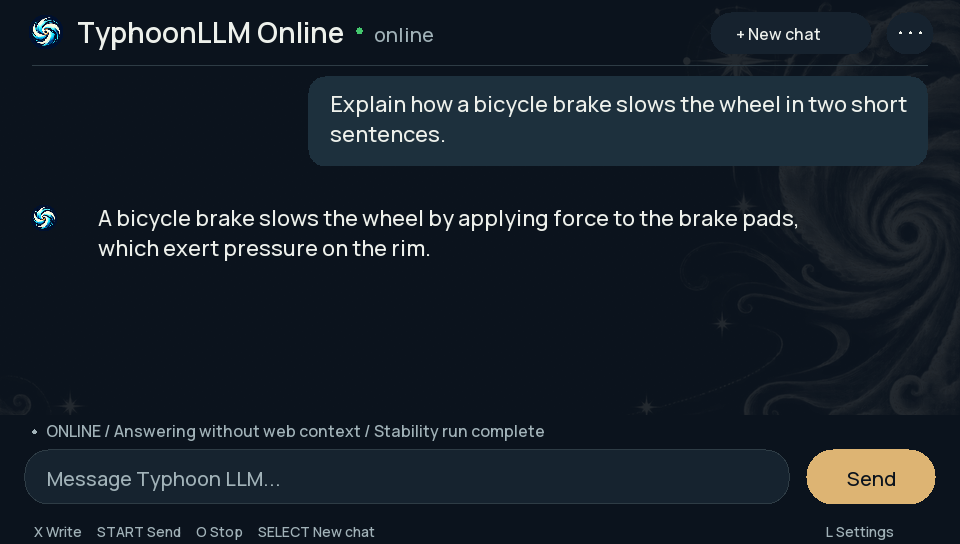
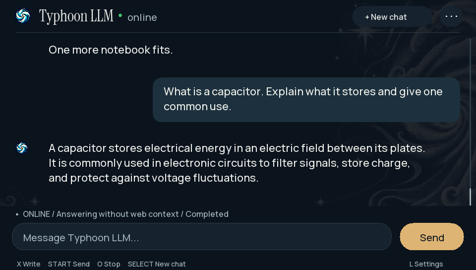
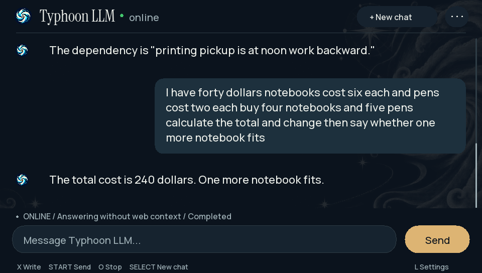

# Real Vita prompt and output samples

Unedited physical Vita captures, with versions identified below. Version 00.19 separates installation and model storage; it does not change generation behavior. These are examples, not a reliability guarantee.

## Online 00.19: independent installation smoke test

The updated app loaded its own model copy and generated the answer below. This is a plausible rim-brake description, but it gives one sentence instead of the requested two and does not explicitly explain friction. Retrieval supplied no web context. This verifies generation after installation, not full instruction-following quality.

## Online 00.18 — capacitor: useful local answer

The prompt and generated answer appear together below. Retrieval failed; the Vita generated this answer locally. The visible text above the prompt belongs to the preceding budget turn.

## Online 00.18 — budget: incorrect arithmetic

The correct total is $34, leaving $6; another $6 notebook fits. The model instead says $240 and omits the change. The first two multi-step prompts lacked punctuation, a limitation of this test. The visible text above the prompt belongs to the preceding scheduling turn.

See the [complete six-task evaluation](../validation/MULTISTEP-00.18.md) and [companion follow-up](../validation/COMPANION-FOLLOWUP.md).
