# Real Vita prompt and output samples

Unedited physical Vita captures, with versions identified below. Version 00.19 separates installation and model storage; it does not change generation behavior. These are examples, not a reliability guarantee.

## Current 01.00: original header restored

Five consecutive physical Vita captures, with no New Chat/CLEAR between prompts. The original header font, size and wording are restored. [Validation and limits](../validation/ONLINE-01.00.md).

### Cloud identity — fetched context

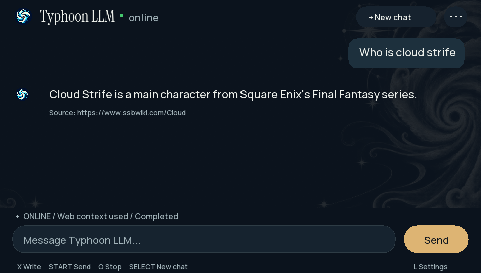

### Weapon follow-up — fetched context

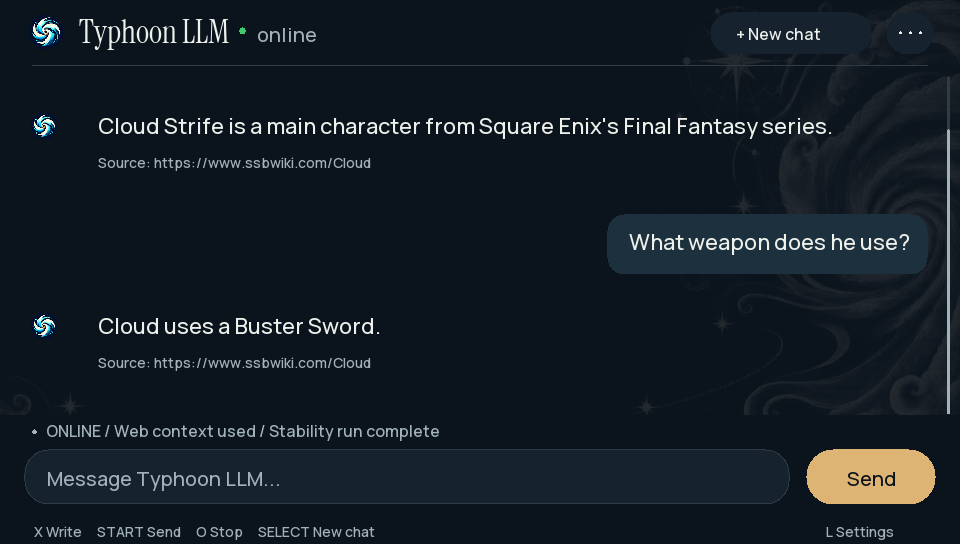

### Ada Lovelace — fetched context

The answer omits the source's “often considered” qualifier.

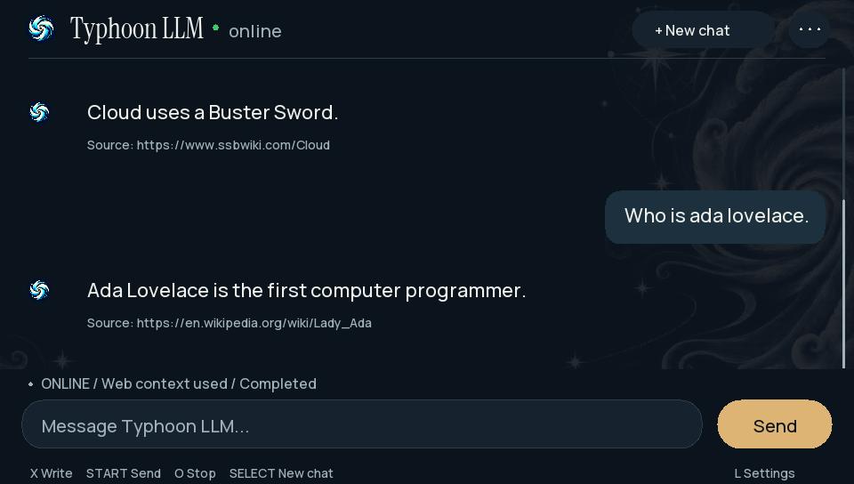

### Rain poem — local generation

The output contains the typo “In de”.

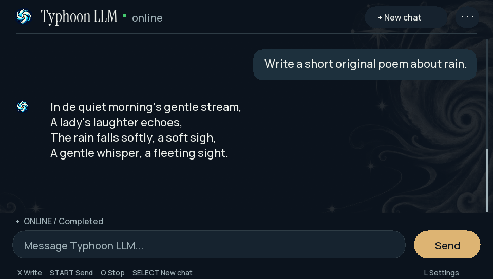

### Cheerful rewrite — local generation

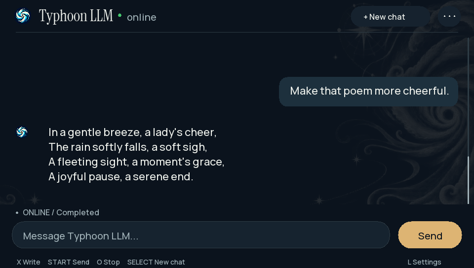

The following older captures are unmodified historical records. The changed header visible in 00.19/00.20 was reverted in 01.00.

## Online 00.20: six prompts in one continuous chat

No New Chat/CLEAR separated these turns. The offline baseline was deliberately incorrect; sourced generation then corrected it. [Full validation and limits](../validation/ONLINE-00.20.md).

### 1. Offline baseline — incorrect identity

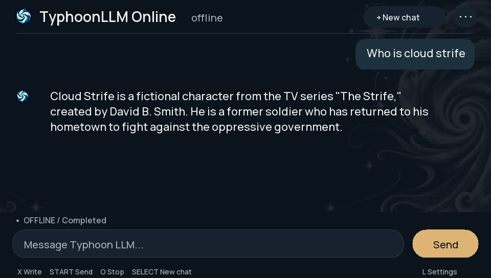

### 2. Identity corrected using fetched context

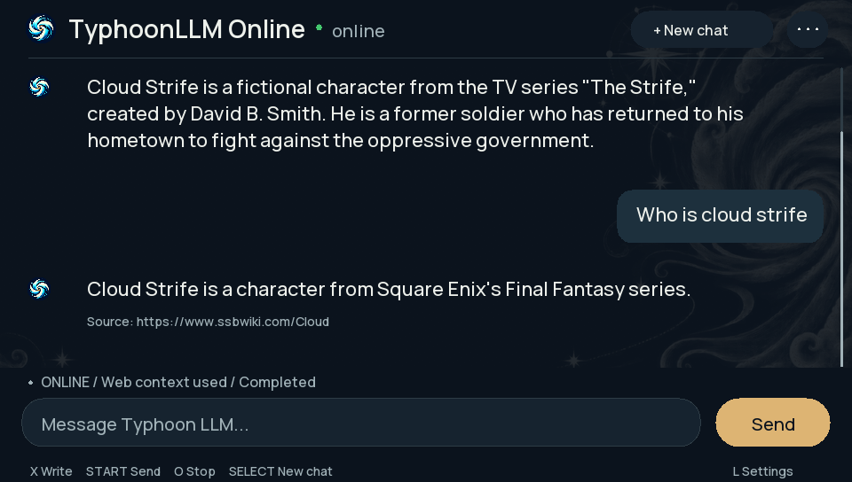

### 3. Sourced weapon follow-up

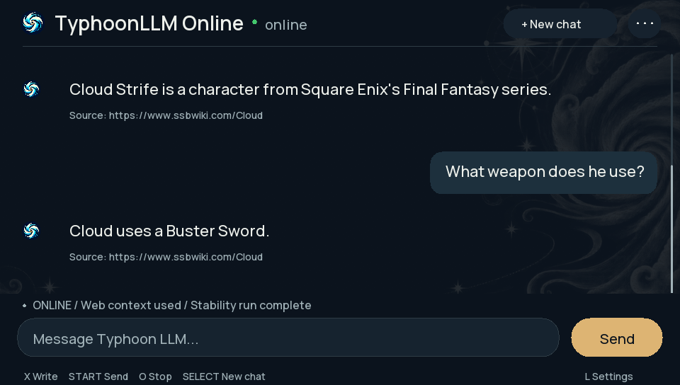

### 4. Unrelated sourced identity

The answer loses the source's “often considered” qualification.

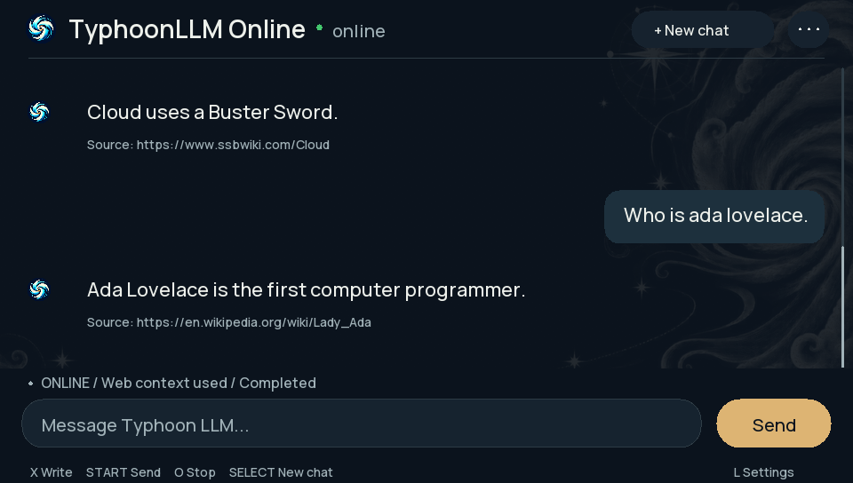

### 5. Original rain poem, no fetch

The generated poem contains the typo “In de”.

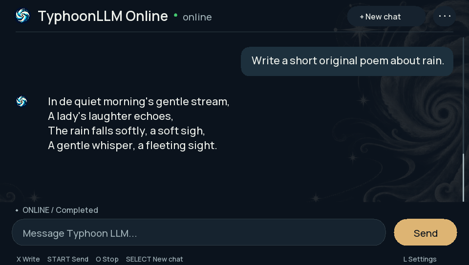

### 6. Cheerful rewrite, no fetch

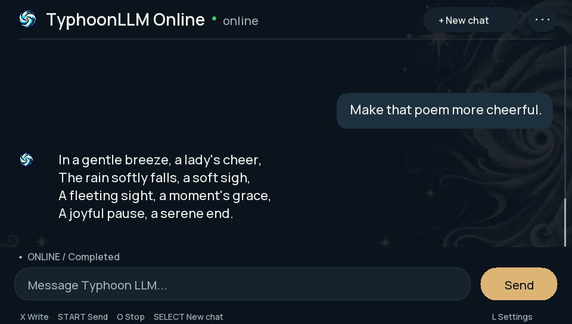

## Online 00.19: independent installation smoke test

The updated app loaded its own model copy and generated the answer below. This is a plausible rim-brake description, but it gives one sentence instead of the requested two and does not explicitly explain friction. Retrieval supplied no web context. This verifies generation after installation, not full instruction-following quality.

## Online 00.18 — capacitor: useful local answer

The prompt and generated answer appear together below. Retrieval failed; the Vita generated this answer locally. The visible text above the prompt belongs to the preceding budget turn.

## Online 00.18 — budget: incorrect arithmetic

The correct total is $34, leaving $6; another $6 notebook fits. The model instead says $240 and omits the change. The first two multi-step prompts lacked punctuation, a limitation of this test. The visible text above the prompt belongs to the preceding scheduling turn.

See the [complete six-task evaluation](../validation/MULTISTEP-00.18.md) and [companion follow-up](../validation/COMPANION-FOLLOWUP.md).
